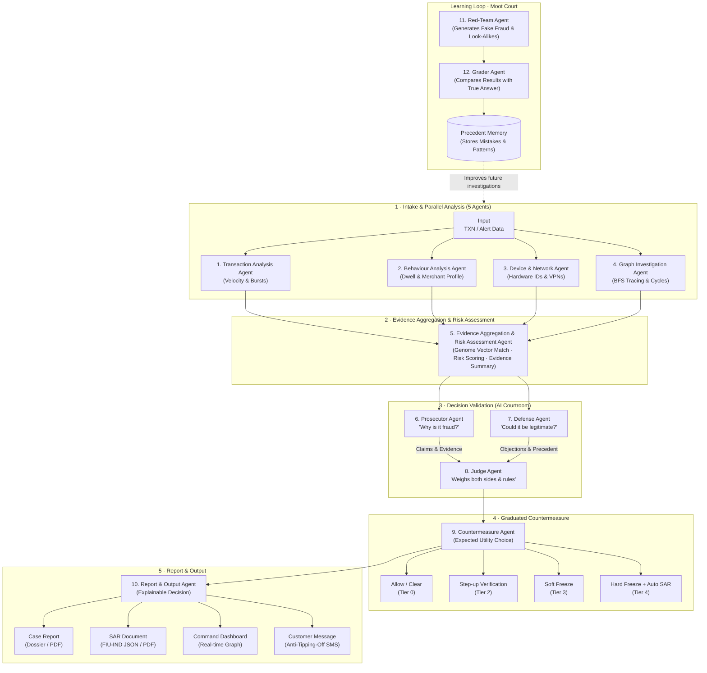

# The Autonomous Fraud Courtroom
**Agentic Fraud Ring Detection and Countermeasure Engine: compressing fraud's half-life from 72 hours to 45 seconds.**

When an alert fires, a Graph Scout follows the money, a Pattern Detector computes facts, a **Prosecutor** argues
for action, a **Defense** agent argues for the innocent, and a **Judge** issues a graduated verdict per account
(hard freeze / soft freeze / step-up / clear) — acting on its own only when confidence ≥ 0.85 **and** a
counterfactual shows no collateral damage. Every night a **Moot Court** red-teams both sides and stores its
mistakes as precedents, so the system gets measurably better.

Design rules: (1) facts from code, reasoning from LLMs; (2) every claim cites an evidence ID, unknown IDs are
rejected; (3) one pipeline, two modes (live / moot); (4) autonomy is gated by confidence + counterfactual +
a tier cap kill switch; (5) every step is written to a hash-chained audit log.

---

## System Architecture

> **"Twelve specialist agents, one accountable decision"**



### The 12 Specialist Agents
1. **Transaction Analysis Agent**: Evaluates transaction velocity, inflow bursts, capital at risk, and cash flow surges.
2. **Behaviour Analysis Agent**: Calculates account dwell time, pass-through speed, historical counterparty consistency, and recurring ratios.
3. **Device & Network Agent**: Uncovers device fingerprint overlaps, shared hardware identifiers, IP clusters, and VPN exit nodes.
4. **Graph Investigation Agent**: Conducts multi-hop downstream BFS money-flow traversal, directed cycle detection, and ring boundary isolation.
5. **Evidence Aggregation & Risk Assessment Agent**: Combines findings, matches ring topology against the fraud genome vector library, and computes Bayesian node risk scores.
6. **Prosecutor Agent**: Argues why activity constitutes fraud, citing deterministic evidence tokens (`EV-...`) and past prosecution precedents.
7. **Defense Agent**: Argues why activity could be legitimate, citing business history, GST registration, long-standing counterparties, and defense precedents.
8. **Judge Agent**: Weighs arguments under deterministic guardrails, runs counterfactual collateral checks, and issues the accountable verdict.
9. **Countermeasure Agent**: Executes calibrated interventions based on expected utility: **Allow**, **Step-up Verification**, **Soft Freeze**, or **Hard Freeze + Auto SAR**.
10. **Report & Output Agent**: Packages decisions into full case dossiers, compliance-ready SAR drafts, customer notices with anti-tipping-off rules, and real-time dashboard events.
11. **Red-Team Agent**: Generates synthetic evasion rings (hop delays, decoys) and framing traps (festivals, payroll) to probe courtroom vulnerabilities.
12. **Grader Agent**: Evaluates trial decisions against ground truth, flags false positives/negatives, and commits lessons to **Precedent Memory**.

---

## Step 1 — Install (Python 3.10+)
```bash
cd fraud-courtroom
python -m venv .venv
source .venv/bin/activate            # Windows: .venv\Scripts\activate
pip install -r requirements.txt
cp .env.example .env                 # Windows: copy .env.example .env
```
Everything runs **offline** with `LLM_PROVIDER=mock`.

## Step 2 — Connect a real LLM (recommended for the demo)
Get a free key from Groq (https://console.groq.com/keys) or Google AI Studio (https://aistudio.google.com/apikey),
then edit `.env`:
```ini
LLM_PROVIDER=groq          # or gemini, openai, openrouter, anthropic, ollama (local, no key)
LLM_API_KEY=your_key
```
Check it before you present:
```bash
python scripts/check_llm.py
```
It pings the model, runs the golden case with the LLM writing the Prosecutor, Defense, Judge and SMS text, and
prints for each agent whether its words came from the LLM or fell back to the template, plus tokens and latency.
The verdict is always computed by code; the LLM argues and explains. Account IDs are masked before any prompt
leaves the machine, every cited evidence ID is validated, rate limits are retried, and answers are cached in
`runtime/llm_cache` so re-running the demo costs nothing. The dashboard shows which model wrote each argument.

## Step 3 — See the court in the terminal
```bash
python scripts/generate_data.py      # writes data/demo (the fixed 3 AM case)
python scripts/run_demo.py
```

## Step 4 — Run the tests
```bash
pytest -q
```
Golden case, detectors, every scenario type through the API with all reports, the real-LLM code path against a
fake provider (retries, invented evidence IDs, masking, cache), the moot court, and the IBM pipeline.

## Step 5 — Start the Fraud Command Center
```bash
uvicorn app.main:app --port 8000
```
Open **http://localhost:8000**. The app is one product with four pages (plus the moot court):

| Route | Page | What the employee does |
|---|---|---|
| `/dashboard` | **Live monitoring** — KPIs, live transaction feed (time, sender, receiver, amount, risk, status), active investigations, recent alerts | watches; nothing interrupts them |
| `/investigations` | all investigations, filter by open / awaiting approval / closed | picks one |
| `/investigations/{id}` | **hero screen** — interactive fraud graph, AI Investigator (progress, assessment, courtroom, agent activity), evidence, account details | investigates |
| `/countermeasures` | recommended actions per network, tick/untick actions, exclude accounts, approve or reject | decides |
| `/moot` | nightly moot court (unchanged) | reviews learning |

**The workflow.** Choose a scenario in the top bar and press **Start feed**. Ordinary payments stream in (background
traffic), every transaction gets a transparent risk score, and when an alert rule fires:

1. an investigation opens **automatically** — nobody clicks "Build graph";
2. a **small toast** appears in the corner (who → whom, amount, risk, "Network investigation started", *View
   investigation*). It never opens a modal and never navigates; at most three toasts show, the rest are grouped;
3. the dashboard card shows the network growing ("Building network… nodes discovered: 5 → 12 → 20") while the
   Scout traces hop by hop, and the toast updates when the investigation is ready;
4. on the investigation page the employee can zoom (wheel), pan (drag), click accounts and transfers, filter by role
   and risk, collapse branches, trace downstream / back to source, and click any evidence item to highlight it.
   Node colour = candidate role (origin / intermediary-mule / cash-out / normal); outer ring = decision
   (dashed + "?" = proposed, awaiting approval). Roles are *candidates from money-flow evidence*, not guilt;
5. **Agent activity** lists every tool call the agents made (`trace_downstream(seed=A, depth=3)`,
   `detect_cycles`, `query_genome_index`, `evaluate_counterfactual_impact`, …) with what came back;
6. on **Countermeasures** the employee approves or rejects. They can untick a whole action (e.g. no step-ups) or
   click an account to keep it unrestricted. Approved actions execute against the mock bank: outbound transfers
   from held accounts show **HELD**, with the balance protected, customer messages and all reports.

**Approval policy** (`.env`):
- `FC_APPROVAL_MODE=employee` (default) — every restrictive action waits for an employee. The court still investigates
  and recommends in seconds; the timer shows *time to recommendation*, then *time to containment* after approval.
- `FC_APPROVAL_MODE=auto` — the original "45-second half-life" demo: confident, collateral-free decisions execute on
  their own; anything else still goes to a human. `FC_MAX_TIER` remains the kill switch in both modes.
- `FC_AMBIENT_TPS=4` — background payments per second during a feed (0 = only the scenario's transactions).

Scenarios (every randomised one is a new case each run):

| Scenario | What happens | A correct court… |
|---|---|---|
| The 3 AM analyst (fixed) | victims → A → B1–B3 → C1–C6, kirana C3 | holds/freezes the ring, step-up for C3 |
| **Rush hour** | two fraud rings + one innocent look-alike, a few minutes apart | three toasts, three investigations; clears the innocent one |
| Mule ring | layered ring, optional round-trip, innocent shop | freezes the ring, protects the shop |
| Smurfing | 30–45 small UPI scam payments → collector → VPN mules | freezes collector + mules |
| Gather-scatter | big inflows scattered to fresh accounts buying gold | freezes mules, protects the gold dealer |
| Slow layered chain | 2–7 min hops, aged mules with decoy history | the hard case: goes to an analyst |
| Payroll run | employer pays 8–14 staff in 2 minutes | clears everyone |
| Diwali wholesale | distributor collects from shops, pays suppliers | clears everyone |
| Family gold sale | relatives share one phone | clears everyone (shared phone ≠ mule ring) |

**Demo script (3 minutes).** Pick *Rush hour* → Start feed. Keep talking over the dashboard: the feed keeps
moving, three toasts arrive minutes apart, the cards count nodes. Open the first ring → click an intermediary
(pass-through, holding time, shared device) → click "Rapid forwarding" evidence → open Agent activity → Review
countermeasures → exclude one account, approve → show HELD transfers and the STR draft. Finish on the innocent case:
"cleared — nobody was blocked."

## Step 6 — Reports
When a case closes, the **Reports** card links to (also `GET /api/reports/<case_id>`):

| Report | Format | For |
|---|---|---|
| Investigation report | HTML (print to PDF) | the full story: network, evidence, arguments, verdict, actions, timeline, AI provenance, audit |
| Executive summary | PDF, one page | management / judges |
| Suspicious Transaction Report draft | PDF + JSON | compliance (only when accounts are frozen) |
| Analyst review packet | HTML | cases the court sent to a human |
| Customer notices | HTML | what each customer is told (and why hard-frozen suspects are not) |
| Audit trail | CSV | SHA-256 hash-chained log |
| Case dossier | JSON | other systems |

Portfolio reports:
```bash
python scripts/evaluate_scenarios.py --per-kind 20   # scenario scorecard (HTML + CSV) over fresh random cases
python -m fraudcourt.moot --rounds 8 --reset          # then open /api/reports/portfolio/moot
```
All generated reports land in `runtime/reports/`.

## Step 7 — Moot Court
From the **Moot court** tab or `python -m fraudcourt.moot --rounds 8 --cases 20 --reset`.

## Step 8 — Held-out validation on the IBM AML dataset
Download `HI-Small_Trans.csv` and `HI-Small_Patterns.txt` from Kaggle
(ealtman2019/ibm-transactions-for-anti-money-laundering-aml), then:
```bash
python scripts/validate_ibm.py --trans HI-Small_Trans.csv --patterns HI-Small_Patterns.txt
```
Protocol: for each sampled laundering attempt (per typology: FAN-OUT, FAN-IN, CYCLE, GATHER-SCATTER,
SCATTER-GATHER, STACK, BIPARTITE, RANDOM) the alert fires on the account a velocity rule would flag; the court sees
only data up to 24 h after the alert (no look-ahead); clean alerts are judged the same way; cases are split by
time — the earlier half calibrates the risk weights (logistic regression), the later half is the test; a simple
baseline is scored alongside. Output: `runtime/reports/ibm-validation.html` + `.csv`.

It is fast: the CSV is parsed once with pandas and cached as `.npz` (2 M rows: 8 s cold, under 1 s cached), and
each case pulls only the transactions it needs via per-account indexes (about 6 ms per case).
No Kaggle download yet? Try the pipeline on an IBM-format synthetic file (not the IBM data):
```bash
python scripts/make_ibm_like_sample.py --out data/ibm_like
python scripts/validate_ibm.py --trans data/ibm_like/SAMPLE_Trans.csv --patterns data/ibm_like/SAMPLE_Patterns.txt
```
State the limits when presenting: IBM has no devices, IPs, account ages or merchant flags (those signals are
switched off), timestamps are per minute, and fan-in senders are treated as victims by design.

## Step 9 (optional) — Feed transactions like a core-banking system
```bash
python scripts/stream_transactions.py --speed 20   # while the server runs
```

## Docker
```bash
docker build -t fraud-courtroom . && docker run -p 8000:8000 --env-file .env fraud-courtroom
```

---

## Project layout
```
fraudcourt/
  config.py        settings (.env)               schemas.py     Evidence, Brief, verdicts, graph state
  graph_store.py   in-memory account/txn graph   simulator.py   demo, evasion and framing scenarios
  detectors.py     trace, cycles, shared attrs   risk.py        transparent weighted risk score
  genome.py        fraud-genome vectors          vector_index.py FAISS or numpy search
  memory.py        precedents + learned policy   decision.py    counterfactual + expected-utility tiers
  llm.py           mock/OpenAI/Anthropic + PII masking            prompts.py  agent prompts
  agents.py        the 9 LangGraph nodes         workflow.py    StateGraph wiring, run_case()
  context.py       per-case evidence registry    events.py      event bus + recordings
  bank.py          mock bank API                 audit.py       hash-chained audit log
  sar.py           SAR JSON + PDF                alerts.py      real-time alert rules
  moot.py          red team, rounds, benchmark   api.py         FastAPI + WebSocket + static UI
  scenarios.py     8 randomised scenario generators  reports.py     dossier + 7 report types
  evaluation.py    batch replay-and-judge            ibm.py         IBM AML loader, index, validation
fraudcourt/txn_risk.py  per-transaction risk score for the live feed (transparent reasons)
frontend/          Fraud Command Center: index.html, app.js, styles.css (vanilla JS, no build step, one event store)
tests/ui/          headless UI walkthrough (jsdom) over a recorded rush-hour run
scripts/           generate_data, run_demo, check_llm, evaluate_scenarios, validate_ibm, make_ibm_like_sample, stream_transactions
tests/             golden case, detectors, moot court, API
```

## API
| Method | Path | Purpose |
|---|---|---|
| POST | `/transactions/ingest` | add one transaction; may open a case |
| GET | `/api/scenarios` | scenario catalogue |
| POST | `/api/demo/run?scenario=random&seed=` | replay a scenario's live transactions |
| POST | `/api/review/{id}` | employee approve / dismiss `{decision, note, approve_tiers?, exclude?}` (partial approval) |
| GET | `/api/investigations` | running + finished investigations (used to restore the UI after a reload) |
| GET | `/api/investigations/{id}/events` | a case's full event stream, live or finished |
| GET | `/api/reports`, `/api/reports/{id}`, `/api/reports/{id}/{kind}` | reports |
| POST | `/api/demo/reset` | reload history only (for an external feed) |
| POST | `/api/investigations` | open a case manually `{seed, alert_time?, reason}` |
| GET | `/api/cases`, `/api/cases/{id}` | case summaries |
| GET | `/api/sar/{id}` | SAR PDF |
| POST | `/api/override/{id}` | analyst release/confirm `{account, decision, note}` |
| GET | `/api/audit/verify` | re-hash the audit chain |
| POST/GET | `/api/moot/run`, `/api/metrics` | moot court |
| GET | `/api/recordings/latest` | last case's event stream |
| * | `/bank/freeze`, `/soft-freeze`, `/step-up`, `/unfreeze/{a}`, `/status/{a}` | mock bank |
| WS | `/ws` | all events |

Events: `demo.started, txn.ingested (risk, reasons, status), alert.raised, case.opened, stage.changed, graph.progress,
agent.tool, graph.snapshot (node stats, edge transactions), graph.nodes_flagged,
graph.edges_protected, evidence.added, risk.scored, agent.started/token/message/brief, verdict.issued,
action.executed, customer.message, approval.decided, case.closed, moot.progress, moot.done`.

UI smoke test (optional, needs Node): `python tests/ui/record_events.py && npm install jsdom@24 && node tests/ui/ui_test.js`
drives the real frontend through dashboard → toast → investigation → countermeasures with a recorded run (45 checks).

## Honesty notes for the pitch
All data is synthetic; business figures (loss avoided, ROI) are simulations and must be labelled as such.
PMLA cash-transaction reporting is ₹10 lakh (₹50,000 relates to PAN quoting). The 45-second figure is the
pipeline time with demo pacing; with `FC_STAGE_DELAY=0` the court decides in about a second.

## Troubleshooting
- Page says "Open this page through the server" → you opened index.html as a file; use http://localhost:8000.
- `409 The demo is already running` → wait for the case to close or press Clear and retry.
- Start fresh: delete the `runtime/` folder (audit log, memory, recordings, SARs, moot metrics).
